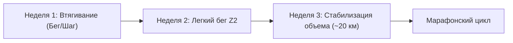

# 🏃‍♂️ Комплексный анализ бегового сезона и план подготовки к марафону Sub-4 (Сентябрь 2027)

---

## 1. Ретроспективный анализ тренировок за последний год (Ноябрь 2025 — Октябрь 2026)

### 📊 Сводная статистика
* **Всего тренировочных сессий:** 66 пробежек (шоссе, пересеченная местность/трейлы, беговое полотно).
* **Суммарный накат за 12 месяцев:** **629.3 км** (73.7 часов чистого движения).
* **Средний объем:** ~52.4 км/месяц (~12–15 км в неделю).
* **Хронологический возраст:** 49 лет | **Фитнес-возраст Garmin:** 46.7 лет (потенциал: 42.5).
* **Пульс покоя в норме (RHR):** 53–55 уд/мин | **Максимальный пульс (HR Max):** 182 уд/мин | **ПАНО (LT HR):** ~163 уд/мин.

```
       ДИНАМИКА КИЛОМЕТРАЖА ПО МЕСЯЦАМ (КМ)
   100 ┼                                        ╭──╮
    80 ┼          ╭──╮                    ╭──╮  │  │
    60 ┼ ╭──╮     │  │              ╭──╮  │  │  │  │  ╭──╮
    40 ┼ │  │     │  │  ╭──╮  ╭──╮  │  │  │  │  │  │  │  │
    20 ┼ │  │ ╭──╮│  │  │  │  │  │  │  │  │  │  │  │  │  │  ╭─╮
     0 ┴─┴──┴─┴──┴┴──┴──┴──┴──┴──┴──┴──┴──┴──┴──┴──┴──┴──┴──┴─┴─
         11   12   01   02   03   04   05   06   07   08   09 10 (2026)
```

### 🏆 Ключевые старты и результаты
| Дата | Событие | Дистанция | Время / Темп | Ср. ЧСС / Макс | Оценка |
| :--- | :--- | :--- | :--- | :--- | :--- |
| **16.11.2025** | Almaty City Run 2025 | 10.23 км | 51:06 (4:59/км) | 171 / 182 | Отличный темповый запас скорости |
| **15.02.2026** | Winter Run 2026 | 9.98 км | 51:06 (5:07/км) | 170 / 177 | Стабильный уровень 10 км ~51 мин |
| **19.04.2026** | Almaty Half Marathon | 21.34 км | 2:09:24 (6:03/км) | 135 / 163 | Спокойный контролируемый бег на низком пульсе |
| **03.05.2026** | Tengri Ultra 2026 (Trail 25) | 25.23 км | 3:02:06 (7:13/км) | 149 / 164 | Хорошая силовая и связочная база |
| **27.09.2026** | **Almaty Marathon 2026 (21.1K)** | **21.26 км** | **1:55:42 (5:26/км)** | **171 / 179** | **Личный рекорд! Выход из 2 часов на полумарафоне** |

---

### 🔍 Ключевые выводы и "узкие места" в тренировках

> [!WARNING] Главные ошибки предыдущего периода
> 1. **Ловушка "серой зоны" (Zone 3–4):**  
>    Большинство обычных тренировок выполнялись в диапазоне пульса **145–155 уд/мин** при темпе 5:50–6:20/км. Тренировочный эффект (Aerobic TE) почти всегда был в диапазоне **4.0–5.0** (чрезмерная нагрузка). В организме практически не развивалась капилляризация и жировой обмен истинной **Зоны 2 (109–126 уд/мин)**.
> 2. **Недостаточный недельный объем для марафона:**  
>    Для полумарафона 1:55:42 текущего объема (15–20 км/нед) хватило благодаря силовой выносливости и характеру. Но для полной дистанции 42.2 км этого недостаточно: без недельного объема хотя бы в 45–55 км на 30–32 км неминуемо наступает истощение гликогена («марафонская стена»).
> 3. **Каденс (частота шагов):**  
>    На стартах каденс составлял отличные **173–176 spm**, однако на регулярных тренировках падал до **150–162 spm** с увеличением вертикальных колебаний (~9 см) и времени контакта с поверхностью (~287 мс).

---

## 2. Анализ текущего состояния и специфика здоровья

* **Пауза в беге:** с **2 октября 2026 г.** (~5 недель без беговых тренировок).
* **Маркеры острой фазы болезни:**
  * **5 октября:** резкое падение ночной вариабельности сердечного ритма (HRV) до **16 мс** (при базовой норме 26–37 мс), суточный стресс поднялся до **63**, Body Battery упал до минимальных **5**.
* **Текущее восстановление (начало ноября):**
  * HRV стабилизировался в коридоре нормы (~29–30 мс).
  * Пульс покоя (RHR) держится на уровне 54–60 уд/мин (норма ~55).
* **Остаточные симптомы (тугоухость правого уха, прием БАДов):**

> [!CAUTION] Важные медицинские ограничения при тренировках с остаточной тугоухостью
> 1. **Защита от ветра и переохлаждения:** на улице обязательно закрывать правое ухо (плотная влаговыводящая спортивная повязка, бафф или шапка с ветрозащитной мембраной). Переохлаждение слухового прохода может спровоцировать обострение евстахиита или сосудистый спазм.
> 2. **Исключение натуживаний (маневра Вальсальвы):** при силовых упражнениях дома или в зале категорически избегать задержки дыхания и натуживания, так как это резко повышает внутрилабиринтное давление во внутреннем ухе.
> 3. **Вестибулярный контроль на беговой дорожке:** при заболеваниях уха может слегка страдать вестибулярный аппарат. На дорожке первые 2–3 тренировки не делайте резких поворотов головы и держитесь в безопасной зоне полотна. При малейшем головокружении — плавная остановка.

---

## 3. Специфика комбинирования: Улица vs Беговая дорожка

| Параметр | Беговая дорожка (Тредмил) | Улица (Асфальт / Грунт) |
| :--- | :--- | :--- |
| **Уклон (Incline)** | **Выставлять 1.0% – 1.5%** (компенсирует отсутствие набегающего потока воздуха) | Естественный рельеф |
| **Основная роль** | Идеально для четкого контроля ЧСС (Зона 2), восстановления и отработки каденса 170+ spm в тепле | Адаптация сухожилий, связок стопы и надкостниц к ударной нагрузке асфальта |
| **Зимний баланс** | 1–2 тренировки в неделю (особенно в мороз, гололед или сильный ветер) | 1 тренировка в неделю (предпочтительно воскресный длительный бег в хорошую погоду) |

---

## 4. Протокол возвращения в строй (Недели 1–3, 3 дня в неделю)



### 🗓 Неделя 1 (Тестовая)
* **Вторник (Дорожка, уклон 1%):** 30 мин чередования: 5 мин ходьба 5.5 км/ч + 5 циклов по (3 мин трусца 8.0 км/ч, ЧСС < 125 + 2 мин шаг 5.5 км/ч).
* **Четверг (Дома / Зал):** ОФП 25 мин (ягодичный мостик, подъемы на носки на двух ногах, легкая планка 3×30 сек) + стретчинг. Без задержек дыхания!
* **Суббота или Воскресенье (Улица, защита уха!):** 35–40 мин быстрой ходьбы с включением 3–4 коротких легких пробежек по 300–400 м. Пульс до 120 уд/мин.

### 🗓 Неделя 2 (Аэробное закрепление)
* **Вторник (Дорожка):** 30–35 мин легкого непрерывного бега на пульсе **115–126 уд/мин** (ориентир темпа: 6:40–7:00/км). Если пульс растет — снизить скорость.
* **Четверг (Дорожка или Улица):** 35 мин: 5 мин разминка + 25 мин бег Z2 + 4 коротких легких ускорения по 15 сек с каденсом 175 spm (для нервно-мышечной связи).
* **Воскресенье (Улица):** Длительная прогулка-кросс: 6–7 км в спокойном темпе (ЧСС строго до 130).

### 🗓 Неделя 3 (Выход на базовый режим)
* **Вторник:** 6 км (Z2, пульс 120–128).
* **Четверг:** 6 км (Z2) + 15 мин ОФП для стоп и голеностопа.
* **Воскресенье:** 8–9 км (легкий длительный бег, ЧСС до 130).  
*Итого объем недели: ~20–21 км.*

---

## 5. Сводный календарь соревнований 2027 года и прогнозы результатов

В течение сезона 2026–2027 вы примете участие во всех ключевых стартах прошлого года, которые логично встроены в макроцикл подготовки к главному целевому марафону:

| Дата | Соревнование | Дистанция | Прошлый результат (2026) | 🎯 Прогноз и цель (2027) | Роль старта в подготовке |
| :--- | :--- | :--- | :--- | :--- | :--- |
| **17.01.2027** | 🏔 Amalgendy Race (VK1000) | 5.1 км (+1000м) | 1:39:48 (19:28/км) | **1:33:00 – 1:36:00** | Силовая горная работа / проверка мощности |
| **14.02.2027** | ❄️ Winter Run 2027 | 10.0 км | 51:06 (5:07/км) | **48:30 – 49:30** *(Sub-50!)* | Проверка скорости и уровня ПАНО |
| **28.02.2027** | ⛰ Alpine Race 2027 | 4.4 км (вертикал) | 1:06:00 (14:51/км) | **1:01:00 – 1:03:00** | Мощность стоп и бедер перед весной |
| **18.04.2027** | 🏅 **Almaty Half Marathon 2027** | **21.1 км** | 1:55:42 (на АМ-2026) | **1:50:30 – 1:52:30** *(PR!)* | **Главный весенний тест готовности** |
| **02.05.2027** | 🌾 Tengri Ultra 2027 | 25.0 км (трейл) | 3:02:06 (7:13/км) | **2:48:00 – 2:54:00** | Объемная длительная + тест гелей |
| **27.06.2027** | 🌲 Tau Jarys 2027 | 12.5 км (трейл) | 1:22:36 (6:37/км) | **1:15:00 – 1:18:00** | Летний скоростной кросс в горах |
| **26.09.2027** | 🏆 **ALMATY MARATHON 2027** | **42.195 км** | *Дебют на 42.2K* | **3:56:00 – 3:58:30 (SUB-4!)** | **ГЛАВНАЯ ЦЕЛЬ ГОДА** |

> 📅 **[Открыть полный календарь всех 140 тренировок по конкретным датам (CALENDAR.md)](CALENDAR.md)**

---

## 6. Персонализированный 3-дневный план до Марафона Sub-4 (46 недель)

Для подготовки к марафону на **3 пробежках в неделю** используется доказанная модель (FIRST / Polarized 3-Day), где каждая пробежка решает строго свою задачу:
1. **День 1 (Вторник): Качественная тренировка** (зимой — темповая база/интервалы на дорожке; весной/летом — ПАНО и марафонский темп).
2. **День 2 (Четверг): Аэробный кросс средней длины** (строго Зона 2, идеальный тренинг жирового обмена).
3. **День 3 (Воскресенье): Длительный кросс (Long Run)** — краеугольный камень марафонской выносливости.

---

### 🔹 ЭТАП 2: Базовый зимний фундамент (Декабрь 2026 — Март 2027, 16 недель)
* **Целевой недельный объем:** рост с **24 км до 38–40 км/нед**.
* **Базовая сетка недели:**
  * **Вторник (Дорожка, уклон 1%):** 8–10 км. Аэробно-силовой бег (например, 2 км разминка + 4–5 повторов по 1 км в темпе 5:45 с уклоном 2% через 2 мин легко + заминка).
  * **Четверг (Дорожка или Улица):** 8–9 км спокойно в Зоне 2 (ЧСС 115–126).
  * **Воскресенье (Улица):** Длительный кросс с прогрессией:
    * Декабрь: 12 ➔ 14 км
    * Январь: 14 ➔ 16 км
    * Февраль: 16 ➔ 18 км
    * Март: 18 ➔ 20–22 км (все в темпе 6:15–6:40/км, ЧСС 125–135).

---

### 🔹 ЭТАП 3: Скоростная выносливость и весенний полумарафон (Апрель — Май 2027, 8 недель)
* **Целевой недельный объем:** **36–45 км/нед**.
* **Базовая сетка недели:**
  * **Вторник:** Пороговые отрезки (ПАНО): разминка 2 км + (3–4 по 2 км в темпе 5:15–5:20/км, ЧСС 158–163 через 400 м трусцы) + заминка.
  * **Четверг:** Восстановительный бег 8–10 км в Зоне 2 + 5 легких ускорений по 80 м на технику.
  * **Воскресенье:** Длительный бег 20–24 км.
* **Контрольный старт (середина мая 2027):** Полумарафон на результат.  
  *Цель:* **1:52:00 – 1:54:00**.

---

### 🔹 ЭТАП 4: Специфический марафонский пик (Июнь — Август 2027, 12 недель)
* **Целевой недельный объем:** **42–52 км/нед**.
* **Базовая сетка недели:**
  * **Вторник (Марафонский темп - MP):** 10–12 км (включая блоки бега по **5:35–5:40/км**, например, 2 км разминка + 8 км в целевом марафонском темпе + 2 км заминка).
  * **Четверг (База):** 10 км спокойно в Зоне 2.
  * **Воскресенье (Ключевые Long Runs с отработкой гелей):**
    * Неделя 1: 24 км (20 км легко + 4 км в темпе марафона 5:40).
    * Неделя 2: 26 км (спокойный равномерный бег, тестирование гелей каждые 40 мин).
    * Неделя 3: 20 км (разгрузочная неделя).
    * Неделя 4: 28 км (22 км легко + 6 км в темпе марафона).
    * Неделя 5: 30–32 км (за 4 недели до марафона — генеральная репетиция питания и гидратации).

---

### 🔹 ЭТАП 5: Тейпер (подводка) и старт Sub-4 (Сентябрь 2027, 3 недели)
* **3 недели до старта:** объем снижается до 32 км (длинная 20 км).
* **2 недели до старта:** объем снижается до 22 км (длинная 14 км в легком темпе).
* **Неделя старта:** 
  * Вт: 5 км легко + 3 ускорения по 100 м в темпе 5:20.
  * Чт: 4 км трусца перед сном.
  * **Воскресенье (20-е числа сентября 2027) — СТАРТ МАРАФОНА:**
    * Раскладка: первые 5 км по 5:45 (втягивание в толпе), далее ровный темп 5:38–5:40/км.
    * Питание: гель каждые 7–8 км (на 7, 15, 22, 29, 35 км) с водой.
    * **Финиш: 3:58:30 – 3:59:30 (SUB-4 ВЫПОЛНЕН!).**
