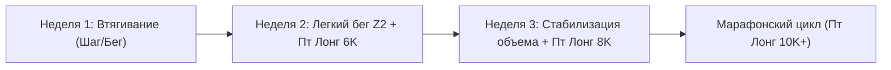
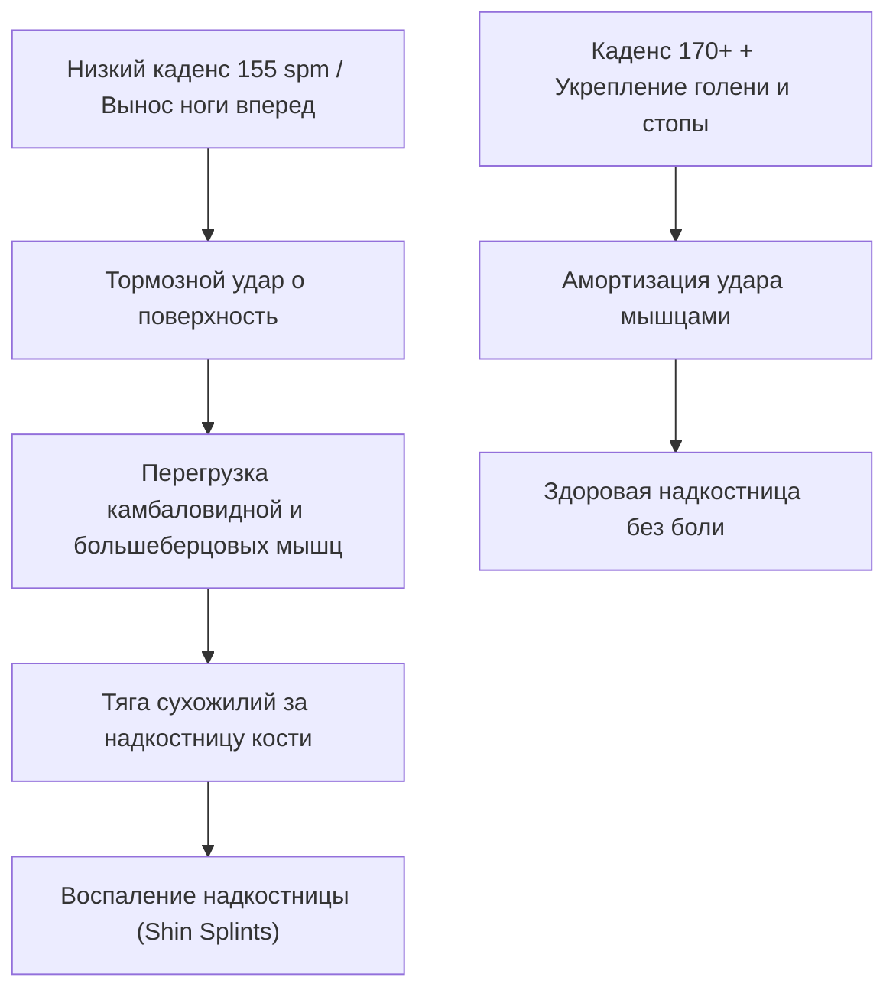

# 🏃‍♂️ Комплексный анализ бегового сезона и план подготовки к марафону Sub-4 (Сентябрь 2027)

---

## 1. Ретроспективный анализ тренировок за последний год (Ноябрь 2025 — Октябрь 2026)

### 📊 Сводная статистика
* **Всего тренировочных сессий:** 66 пробежек (шоссе, пересеченная местность/трейлы, беговое полотно).
* **Суммарный накат за 12 месяцев:** **629.3 км** (73.7 часов чистого движения).
* **Средний объем:** ~52.4 км/месяц (~12–15 км в неделю).
* **Хронологический возраст:** 49 лет | **Фитнес-возраст Garmin:** 46.7 лет (потенциал: 42.5).
* **Пульс покоя в норме (RHR):** 53–55 уд/мин | **Максимальный пульс (HR Max):** 182 уд/мин | **ПАНО (LT HR):** ~163 уд/мин.

```
       ДИНАМИКА КИЛОМЕТРАЖА ПО МЕСЯЦАМ (КМ)
   100 ┼                                        ╭──╮
    80 ┼          ╭──╮                    ╭──╮  │  │
    60 ┼ ╭──╮     │  │              ╭──╮  │  │  │  │  ╭──╮
    40 ┼ │  │     │  │  ╭──╮  ╭──╮  │  │  │  │  │  │  │  │
    20 ┼ │  │ ╭──╮│  │  │  │  │  │  │  │  │  │  │  │  │  │  ╭─╮
     0 ┴─┴──┴─┴──┴┴──┴──┴──┴──┴──┴──┴──┴──┴──┴──┴──┴──┴──┴──┴─┴─
         11   12   01   02   03   04   05   06   07   08   09 10 (2026)
```

### 🏆 Ключевые старты и результаты
| Дата | Событие | Дистанция | Время / Темп | Ср. ЧСС / Макс | Оценка |
| :--- | :--- | :--- | :--- | :--- | :--- |
| **16.11.2025** | Almaty City Run 2025 | 10.23 км | 51:06 (4:59/км) | 171 / 182 | Отличный темповый запас скорости |
| **15.02.2026** | Winter Run 2026 | 9.98 км | 51:06 (5:07/км) | 170 / 177 | Стабильный уровень 10 км ~51 мин |
| **19.04.2026** | Almaty Half Marathon | 21.34 км | 2:09:24 (6:03/км) | 135 / 163 | Спокойный контролируемый бег на низком пульсе |
| **03.05.2026** | Tengri Ultra 2026 (Trail 25) | 25.23 км | 3:02:06 (7:13/км) | 149 / 164 | Хорошая силовая и связочная база |
| **27.09.2026** | **Almaty Marathon 2026 (21.1K)** | **21.26 км** | **1:55:42 (5:26/км)** | **171 / 179** | **Личный рекорд! Выход из 2 часов на полумарафоне** |

---

### 🔍 Ключевые выводы и "узкие места" в тренировках

> [!WARNING] Главные ошибки предыдущего периода
> 1. **Ловушка "серой зоны" (Zone 3–4):**  
>    Большинство обычных тренировок выполнялись в диапазоне пульса **145–155 уд/мин** при темпе 5:50–6:20/км. Тренировочный эффект (Aerobic TE) почти всегда был в диапазоне **4.0–5.0** (чрезмерная нагрузка). В организме практически не развивалась капилляризация и жировой обмен истинной **Зоны 2 (109–126 уд/мин)**.
> 2. **Недостаточный недельный объем для марафона:**  
>    Для полумарафона 1:55:42 текущего объема (15–20 км/нед) хватило благодаря силовой выносливости и характеру. Но для полной дистанции 42.2 км этого недостаточно: без недельного объема хотя бы в 45–55 км на 30–32 км неминуемо наступает истощение гликогена («марафонская стена»).
> 3. **Каденс (частота шагов):**  
>    На стартах каденс составлял отличные **173–176 spm**, однако на регулярных тренировках падал до **150–162 spm** с увеличением вертикальных колебаний (~9 см) и времени контакта с поверхностью (~287 мс).

---

## 2. Анализ текущего состояния и специфика здоровья

* **Пауза в беге:** с **2 октября 2026 г.** (~5 недель без беговых тренировок).
* **Маркеры острой фазы болезни:**
  * **5 октября:** резкое падение ночной вариабельности сердечного ритма (HRV) до **16 мс** (при базовой норме 26–37 мс), суточный стресс поднялся до **63**, Body Battery упал до минимальных **5**.
* **Текущее восстановление (начало ноября):**
  * HRV стабилизировался в коридоре нормы (~29–30 мс).
  * Пульс покоя (RHR) держится на уровне 54–60 уд/мин (норма ~55).
* **Остаточные симптомы (тугоухость правого уха, прием БАДов):**

> [!CAUTION] Важные медицинские ограничения при тренировках с остаточной тугоухостью
> 1. **Защита от ветра и переохлаждения:** на улице обязательно закрывать правое ухо (плотная влаговыводящая спортивная повязка, бафф или шапка с ветрозащитной мембраной). Переохлаждение слухового прохода может спровоцировать обострение евстахиита или сосудистый спазм.
> 2. **Исключение натуживаний (маневра Вальсальвы):** при силовых упражнениях дома или в зале категорически избегать задержки дыхания и натуживания, так как это резко повышает внутрилабиринтное давление во внутреннем ухе.
> 3. **Вестибулярный контроль на беговой дорожке:** при заболеваниях уха может слегка страдать вестибулярный аппарат. На дорожке первые 2–3 тренировки не делайте резких поворотов головы и держитесь в безопасной зоне полотна. При малейшем головокружении — плавная остановка.

---

## 3. Специфика комбинирования: Улица vs Беговая дорожка

| Параметр | Беговая дорожка (Тредмил) | Улица (Асфальт / Грунт) |
| :--- | :--- | :--- |
| **Уклон (Incline)** | **Выставлять 1.0% – 1.5%** (компенсирует отсутствие набегающего потока воздуха) | Естественный рельеф |
| **Основная роль** | Идеально для четкого контроля ЧСС (Зона 2), восстановления и отработки каденса 170+ spm в тепле | Адаптация сухожилий, связок стопы и надкостниц к ударной нагрузке асфальта |
| **Зимний баланс** | 1–2 тренировки в неделю (особенно в мороз, гололед или сильный ветер) | 1 тренировка в неделю (предпочтительно воскресный длительный бег в хорошую погоду) |

---

## 4. Протокол возвращения в строй (Недели 1–3, 3 дня в неделю: Вт, Чт, Пт - Лонг)



### 🗓 Неделя 1 (Текущая, тестовая)
* **Четверг (05.11, Дорожка, уклон 1%):** 30 мин чередования: 5 мин ходьба 5.5 км/ч + 4 цикла (3 мин трусца 8.0 км/ч, ЧСС < 125 + 2 мин шаг). Контроль уха! *(Выполнено)*.
* **Воскресенье (08.11, Улица, бафф/шапка!):** 35–40 мин быстрой ходьбы с включением 4 отрезков легкого бега по 400 м. Пульс строго до 120 уд/мин. Завершение тестовой недели.

---

### 🗓 Неделя 2 (Со следующей недели — переход на график «Вт, Чт, Пт-лонг»)
* **Вторник (10.11, Дорожка):** 30–35 мин: 5 мин шаг + 25 мин легкого непрерывного бега на пульсе **115–125 уд/мин** (каденс 168+ spm) + **Комплекс профилактики надкостницы №1** (10 мин).  
  *Альтернатива при боли/непогоде:* 30 мин гребля Z2 (ЧСС 115–120).
* **Среда (11.11, Дома):** 🚣 **Гребной тренажер Z1 (Active Recovery):** 20–25 мин легчайшей гребли (18–20 SPM, ЧСС строго **105–120 уд/мин**) + МФР икр.
* **Четверг (12.11, Дорожка/Улица):** 30 мин поддерживающего бега в Зоне 2 (ЧСС 118–125). *Щадящий режим: не утомлять ноги перед завтрашней первой длительной!* + **Комплекс надкостницы №2**.  
  *Альтернатива:* 35 мин гребля Z2.
* **Пятница (13.11, Улица или Дорожка):** 👑 **ПЕРВЫЙ ЛОНГ: 6.0 км** в спокойном разговорном темпе (6:45–7:00/км), ЧСС < 128. Контрастный душ на голени после пробежки.  
  *Альтернатива:* 40 мин гребля Z2.
* **Суббота – Воскресенье (14–15.11):** Полный отдых от бега, восстановление мышц, прогулки.

---

### 🗓 Неделя 3 (Закрепление нового режима)
* **Вторник (17.11):** 6.0 км (Z2, темп 6:30–6:45/км, каденс 170 spm) + Комплекс надкостницы №1.
* **Среда (18.11):** Гребной тренажер Z1 (25 мин, ЧСС 105–120) + растяжка камбаловидных мышц.
* **Четверг (19.11):** 5.5 км (Z2) + 3 легких набегания по 50 м накатом + Комплекс надкостницы №2.
* **Пятница (20.11):** 👑 **ЛОНГ: 8.0 км** (ЧСС строго до 130). Свободные выходные впереди!  
*Итого объем недели: ~19.5–20 км.*

---

## 5. Сводный календарь соревнований 2027 года и прогнозы результатов

В течение сезона 2026–2027 вы примете участие во всех ключевых стартах прошлого года, которые логично встроены в макроцикл подготовки к главному целевому марафону:

| Дата | Соревнование | Дистанция | Прошлый результат (2026) | 🎯 Прогноз и цель (2027) | Роль старта в подготовке |
| :--- | :--- | :--- | :--- | :--- | :--- |
| **17.01.2027** | 🏔 Amalgendy Race (VK1000) | 5.1 км (+1000м) | 1:39:48 (19:28/км) | **1:33:00 – 1:36:00** | Силовая горная работа / проверка мощности |
| **14.02.2027** | ❄️ Winter Run 2027 | 10.0 км | 51:06 (5:07/км) | **48:30 – 49:30** *(Sub-50!)* | Проверка скорости и уровня ПАНО |
| **28.02.2027** | ⛰ Alpine Race 2027 | 4.4 км (вертикал) | 1:06:00 (14:51/км) | **1:01:00 – 1:03:00** | Мощность стоп и бедер перед весной |
| **18.04.2027** | 🏅 **Almaty Half Marathon 2027** | **21.1 км** | 1:55:42 (на АМ-2026) | **1:50:30 – 1:52:30** *(PR!)* | **Главный весенний тест готовности** |
| **02.05.2027** | 🌾 Tengri Ultra 2027 | 25.0 км (трейл) | 3:02:06 (7:13/км) | **2:48:00 – 2:54:00** | Объемная длительная + тест гелей |
| **27.06.2027** | 🌲 Tau Jarys 2027 | 12.5 км (трейл) | 1:22:36 (6:37/км) | **1:15:00 – 1:18:00** | Летний скоростной кросс в горах |
| **26.09.2027** | 🏆 **ALMATY MARATHON 2027** | **42.195 км** | *Дебют на 42.2K* | **3:56:00 – 3:58:30 (SUB-4!)** | **ГЛАВНАЯ ЦЕЛЬ ГОДА** |

> 📅 **[Открыть полный календарь всех 140 тренировок по конкретным датам (CALENDAR.md)](CALENDAR.md)**  
> 📲 **[Автоматическая синхронизация плана с часами и календарем Garmin (scripts/README.md)](scripts/README.md)**

---

## 6. Персонализированный 3-дневный план до Марафона Sub-4 (Вт, Чт, Пт - Лонг)

Для подготовки к марафону на **3 пробежках в неделю** используется оптимизированная модель (FIRST / Polarized 3-Day), адаптированная под график **Вторник, Четверг, Пятница (лонг)**:
1. **День 1 (Вторник): Качественная тренировка** (зимой — темповая база/интервалы/горки на дорожке; весной/летом — ПАНО и марафонский темп MP) + **Комплекс профилактики надкостницы №1**.
2. **День 2 (Четверг): Аэробный восстановительный кросс Z2** (строго Зона 2, 115–125 уд/мин, щадящий километраж 7–9 км для сохранения свежести мышц перед завтрашним днем) + **Комплекс профилактики надкостницы №2**.
3. **День 3 (Пятница): 👑 Длительный кросс (Long Run)** — краеугольный камень марафонской выносливости (рост от 6 до 32 км на пике). Выполняется в пятницу, оставляя субботу и воскресенье полностью свободными для семьи, восстановления мышц или легкой разгрузочной гребли Z1.
*Примечание:* В недели соревнований (все старты проходят в воскресенье) в пятницу выполняется отдых, а соревновательный забег проходит в воскресенье!

---

### 🔹 ЭТАП 2: Базовый зимний фундамент (Декабрь 2026 — Март 2027, 16 недель)
* **Целевой недельный объем:** рост с **24 км до 38–40 км/нед**.
* **Базовая сетка недели:**
  * **Вторник (Дорожка, уклон 1.5–2%):** 8–10 км. Аэробно-силовой бег (например, 2 км разминка + 4–5 повторов по 1 км в темпе 5:45 с уклоном 2% через 2 мин легко + заминка).
  * **Четверг (Дорожка или Улица):** 7–8 км спокойно в Зоне 2 (ЧСС 115–125). Бережем ноги перед пятницей!
  * **Пятница (Улица):** 👑 Длительный кросс (Long Run) с прогрессией:
    * Декабрь: 11 ➔ 14 км (пик 18 км)
    * Январь: 14 ➔ 16 км
    * Февраль: 14 ➔ 16 км (с отработкой стартов Amalgendy и Winter Run)
    * Март: 18 ➔ 20–22 км (все в темпе 6:15–6:35/км, ЧСС 125–134).

---

### 🔹 ЭТАП 3: Скоростная выносливость и весенний полумарафон (Апрель — Май 2027, 8 недель)
* **Целевой недельный объем:** **36–45 км/нед**.
* **Базовая сетка недели:**
  * **Вторник:** Пороговые отрезки (ПАНО): разминка 2 км + (3–4 по 2 км в темпе 5:15–5:20/км, ЧСС 158–163 через 400 м трусцы) + заминка.
  * **Четверг:** Восстановительный бег 7–8 км в Зоне 2 + 4 легких ускорения по 80 м на технику.
  * **Пятница:** 👑 Длительный бег 18–22 км.
* **Главный весенний старт (18 апреля 2027):** Almaty Half Marathon 21.1 км.  
  *Цель:* **1:50:30 – 1:52:30 (Личный рекорд!)**.

---

### 🔹 ЭТАП 4: Специфический марафонский пик (Июнь — Август 2027, 12 недель)
* **Целевой недельный объем:** **42–52 км/нед**.
* **Базовая сетка недели:**
  * **Вторник (Марафонский темп - MP):** 10–12 км (включая блоки бега по **5:35–5:40/км**, например, 2 км разминка + 8 км в целевом марафонском темпе + 2 км заминка).
  * **Четверг (База):** 8–9 км спокойно в Зоне 2.
  * **Пятница (Ключевые Long Runs с отработкой гелей):**
    * Неделя 1: 20 км (16 км легко + 4 км в темпе марафона 5:38).
    * Неделя 2: 24–26 км (спокойный равномерный бег, тестирование гелей каждые 40 мин).
    * Неделя 3: 20 км (разгрузочная неделя).
    * Неделя 4: 28 км (22 км легко + 6 км в темпе марафона).
    * Неделя 5: 👑👑 **32 км (Королевская тренировка 20 августа)** — генеральная репетиция марафона в соревновательной экипировке!

---

### 🔹 ЭТАП 5: Тейпер (подводка) и старт Sub-4 (Сентябрь 2027, 3 недели)
* **3 недели до старта:** объем снижается до 32 км (пятничный лонг 18–20 км).
* **2 недели до старта:** объем снижается до 22 км (пятничный лонг 14 км в легком темпе).
* **Неделя старта:** 
  * Вт (21.09): 5 км легко + 3 ускорения по 80 м в темпе 5:20.
  * Чт (23.09): 3.5–4 км тонизирующая трусца.
  * Пт (24.09): Полный день отдыха, углеводная загрузка.
  * **Воскресенье (26.09.2027) — СТАРТ МАРАФОНА (42.195 км):**
    * Раскладка: первые 5 км по 5:45 (втягивание в толпе), далее ровный темп **5:38–5:40/км**.
    * Питание: гель каждые 7 км (на 7, 14, 21, 28, 35 км) с водой.
    * **Финиш: 3:56:00 – 3:58:30 (SUB-4 ВЫПОЛНЕН!).**

---

## 7. Интеграция гребного тренажера в подготовку (Кросс-тренинг и активное восстановление)

Наличие домашнего гребного тренажера — **огромное стратегическое преимущество** для подготовки к марафону, особенно в возрасте 49 лет и при выходе из болезни.

### 🚣 Почему гребля идеальна для марафонца:
1. **Нулевая ударная нагрузка (Zero-Impact Cardio):**  
   При беге каждый шаг создает ударную перегрузку в 2.5–3 веса тела на коленные суставы, ахиллы и надкостницы. Гребля нагружает сердечно-сосудистую систему так же мощно, как бег, но **без единого микроудара**. Это позволяет безопасно повышать аэробный объем без риска перегрузочных травм.
2. **Включение 85% мышц тела и мощный кор:**  
   Бег почти не развивает мышцы верхней части спины и кора. На 30–35 км марафона уставший кор «складывается», бегун горбится, дыхание становится поверхностным, падают каденс и скорость. Гребля укрепляет всю заднюю мышечную цепь (ягодицы, бицепсы бедра, широчайшие мышцы спины, ромбовидные мышцы), позволяя держать идеальную вертикальную осанку на протяжении всех 42 км.
3. **Безопасность для правого уха в мороз:**  
   В дни сильного ветра, метели или гололеда домашняя гребля позволяет провести первоклассную аэробную работу в тепле без риска переохладить слуховой проход.

### 📋 3 сценария использования гребного тренажера в неделе:

| Сценарий | Когда выполнять | Длительность и режим | Зачем |
| :--- | :--- | :--- | :--- |
| **1. Активное восстановление (Active Recovery)** | **Среда или Суббота** (дни отдыха от бега) | 20–30 мин, легкий темп (18–22 SPM), ЧСС строго **105–120 уд/мин** (Z1) | Ускоряет выведение метаболитов, разгоняет лимфу, снимает забитость ног перед длительным бегом. |
| **2. Замена бега при непогоде / дискомфорте связок** | **Вторник или Четверг** (вместо базового кросса) | 40–50 мин в Зоне 2 (ЧСС 115–126), темп гребков 20–24 SPM | Полноценная замена кросса 7–8 км по кардионагрузке без воздействия на суставы. |
| **3. Заминка / аэробный хвост** | **Вторник или Четверг** (сразу после бега) | 10–12 мин очень легкой гребли на слабом сопротивлении | Разгрузка поясницы, переключение кровотока на верхний плечевой пояс. |

### ⚙️ Настройки и техника безопасности:
* **Уровень сопротивления (демпфер):** выставляйте **строго на 3–5** (Drag Factor ~115–125). Никогда не ставьте на 10 — это перегружает поясницу!
* **Дыхание без натуживания:** мощный выдох носом/ртом на толчке ногами (drive), спокойный вдох на возврате (recovery). Ни в коем случае не задерживайте дыхание, чтобы не создавать скачков давления на барабанную перепонку и внутреннее ухо.

---

## 8. Профилактика воспаления надкостниц (Shin Splints / MTSS)

> [!IMPORTANT] Биомеханическая причина болей в надкостницах
> Воспаление надкостницы (периостит / MTSS) возникает не из-за слабой кости, а из-за **переутомления глубоких мышц голени** (камбаловидной, задней и передней большеберцовых) и **слабости свода стопы**. Когда эти мышцы устают, они перестают гасить ударную волну, и сухожилия буквально «отрывают» надкостницу от большеберцовой кости.  
> 
> На правой ноге боль была сильнее из-за **оверстрайдинга (overstriding)** — выноса ноги слишком далеко вперед на тренировках с низким каденсом (**150–160 spm** по данным ваших часов), при котором правая нога принимала на себя тормозящий удар.



---

### 🛡 Специфический комплекс ЛФК/ОФП «Здоровые надкостницы»
Выполнять **2 раза в неделю** (во **Вторник** и **Четверг** после пробежки/дорожки или в дни отдыха). Занимает всего **10–12 минут**.

| № | Упражнение | Нагрузка | Целевая мышца и эффект |
| :-: | :--- | :--- | :--- |
| **1** | **Подъемы носков у стены (Tibialis Wall Raises)**<br>Встать спиной к стене, пятки на 20–30 см от стены. Поднимать носки стоп максимально на себя, задерживаясь на 1 сек вверху. | 3 подхода по 15–20 повторений | **Передняя большеберцовая мышца.** Создает мощный амортизационный буфер, предотвращает «шлепанье» стопой. |
| **2** | **Подъемы на носок с согнутым коленом (Bent-Knee Calf Raises)**<br>Сидя с гантелью/бутылкой на колене (или стоя у стены в полуприседе). Медленный подъем на носок и медленный спуск 3 сек. | 3 подхода по 15 повторений на каждую ногу | **Камбаловидная мышца (Soleus).** Главный поглотитель ударной нагрузки в беге (гасит до 6–8 весов тела). |
| **3** | **Подъем на носки с теннисным мячом между пятками**<br>Зажать теннисный мяч между пятками сзади и выполнять подъемы на носки, не роняя мяч. | 3 подхода по 12–15 повторений | **Задняя большеберцовая мышца.** Удерживает продольный свод стопы, блокирует заваливание стопы внутрь (гиперпронацию). |
| **4** | **«Короткая стопа» (Short Foot / Foot Doming)**<br>Стоя босиком, подтягивать основание пальцев к пятке, поднимая свод стопы без сгибания пальцев. | 3 подхода по 10 удержаний по 5 сек на ногу | **Глубокие мышцы свода стопы.** Формирует упругую арку стопы. |
| **5** | **«Ракушка» (Clamshell) или Боковая планка**<br>Лежа на боку с согнутыми коленями, разведение коленей (можно с фитнес-резинкой). | 3 подхода по 15 повторений на правую и левую сторону | **Средняя ягодичная мышца (Gluteus Medius).** Предотвращает заваливание колена внутрь (вальгус), которое скручивает правую голень. |

---

### 🏃‍♂️ 3 биомеханических правила на пробежках для защиты надкостниц:

1. **Рост каденса до 168–174 spm:**  
   Главное лекарство от периостита. Чем чаще шаги, тем короче полет и меньше вертикальное колебание (снижаем с текущих 9 см до 7–8 см). Нога приземляется строго **под таз**, а не перед собой.
2. **МФР (Самомассаж) — Правило запретной зоны:**  
   * **МОЖНО И НУЖНО:** раскатывать массажным валиком или мячом икроножные мышцы, камбаловидную мышцу сзади и внешнюю сторону голени (мягкие ткани).
   * **СТРОГО ЗАПРЕЩЕНО:** катать валик прямо по передней или внутренней поверхности большеберцовой кости (по самой надкостнице). Это лишь механически травмирует и без того воспаленную надкостницу!
3. **Обувь и покрытие:**  
   * В период набора объема избегайте «тонких соревновательных марафонок» на жестком асфальте. Используйте кроссовки категории Daily Trainer с хорошей пеной и умеренным перепадом (дропом) 8–10 мм (это разгружает ахилл и камбаловидную мышцу).
   * Зимой беговая дорожка дает идеальное упругое полотно с микроамортизацией, защищая надкостницы на этапе восстановления.
